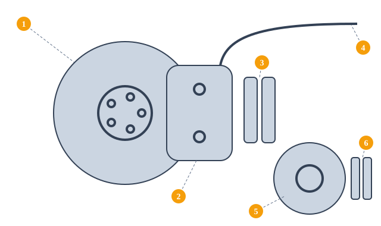
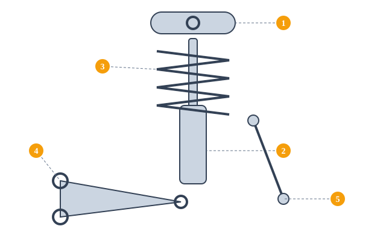
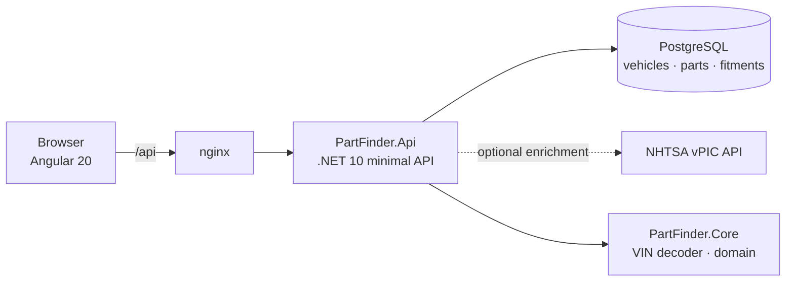

# PartFinder – VIN-based Car Parts Webshop

[](https://github.com/tibortoth8807/AutoWebshopPartfinder/actions/workflows/ci.yml)


**An auto parts webshop where you type in your car's VIN and only see parts that actually fit.**

Finding the right brake disc for a car is harder than it looks: the same model has several engines, years and axle variants.
PartFinder solves the first step the way professional parts shops do: **identify the exact vehicle from its VIN**, then filter the catalog by fitment.
Parts can also be picked on **clickable exploded-view diagrams**.

> Portfolio project. The shop name, logo, design, brands, article numbers, prices and diagrams are all original / fictional – no third-party catalog data is used.

## At a glance

- **VIN decoder written from scratch** (ISO 3779): structure check, manufacturer from the WMI code, North-American check digit, and model year from the 10th character (which repeats every 30 years – the catalog's production years resolve the ambiguity).
- **External API integration** with the public **NHTSA vPIC** service, with retries, timeouts and circuit breaker – the shop keeps working if the service is down.
- **Fitment model**: parts ↔ vehicle variants (make → generation → engine) many-to-many, filtered server-side.
- **Exploded-view diagrams** (own SVG artwork): click the brake disc on the drawing → the list shows brake discs for your car.
- **Modern Angular**: standalone components, signals, zoneless change detection, new control flow, lazy-loaded routes.
- **One command to run**: `docker compose up`.

| Brake system | Suspension |
|---|---|
|  |  |

## Skills demonstrated

| Area | Technologies / practices |
|---|---|
| Backend | .NET 10, C#, ASP.NET Core minimal APIs, EF Core, PostgreSQL, OpenAPI, ProblemDetails |
| Integration | Typed `HttpClient`, `Microsoft.Extensions.Http.Resilience` (retry, timeout, circuit breaker), graceful degradation |
| Frontend | Angular 20, TypeScript, signals, RxJS (`switchMap`, debounce), zoneless, lazy routes, SVG |
| Domain logic | VIN decoding & validation, check digit algorithm, vehicle fitment matching |
| Quality | xUnit unit tests for the decoder and matching rules, Central Package Management, nullable reference types |
| DevOps | Docker multi-stage builds (non-root runtime), Docker Compose, GitHub Actions |

## Architecture



| Project | Responsibility |
|---|---|
| `PartFinder.Core` | VIN decoder, WMI registry, catalog domain (`Vehicle`, `Part`, `Category`). No framework dependencies. |
| `PartFinder.Infrastructure` | EF Core `DbContext`, demo catalog seeder, NHTSA client with resilience pipeline |
| `PartFinder.Api` | Minimal API endpoints: VIN lookup, vehicle selector, categories, part search |
| `frontend/` | Angular shop: VIN search, vehicle selector, catalog with diagrams, cart |
| `tests/PartFinder.Tests` | Unit tests: check digit, model years, validation messages, VIN ↔ vehicle matching |

## Try it

```bash
docker compose up --build
```

- Shop: http://localhost:4200
- API: http://localhost:8080 – OpenAPI at `/openapi/v1.json`

Sample VINs (fictional serial numbers):

| VIN | Vehicle |
|---|---|
| `WVWZZZ1JZ3W386752` | Volkswagen Golf IV, 2003 |
| `TMBZZZ1ZZ8P012345` | Škoda Octavia II, 2008 |
| `W0L0AHL4865012345` | Opel Astra H, 2006 |
| `1HGCM82633A004352` | Honda Accord (US) – valid check digit, NHTSA data, not in the demo catalog |

### Local development

```bash
docker compose up -d db                     # PostgreSQL only
dotnet run --project src/PartFinder.Api     # API on :8080
cd frontend && npm install && npm start     # Angular on :4200 (proxies /api)
dotnet test PartFinder.slnx
```

## API

| Method | Route | Description |
|---|---|---|
| `GET` | `/api/vin/{vin}` | Decode VIN, matching vehicle variants, optional NHTSA data |
| `GET` | `/api/vehicles/makes` | Makes for the selector |
| `GET` | `/api/vehicles?make=&model=` | Vehicle variants |
| `GET` | `/api/categories` | Category tree (with diagram ids) |
| `GET` | `/api/parts?vehicleId=&category=&diagramKey=&q=&sort=&page=` | Part search with fitment filter and paging |
| `GET` | `/api/parts/{id}` | Part details |

## Roadmap

- [ ] Checkout: orders API, stock reservation
- [ ] Free-text search with AI ("fékbetét a 2004-es Golfomhoz" → vehicle + category)
- [ ] Integration tests with `WebApplicationFactory` + Testcontainers
- [ ] More diagrams (exhaust, engine cooling), part detail page
- [ ] EF Core migrations, Playwright E2E tests

## Author

**Tibor Tóth** – Senior .NET Developer (C#, ASP.NET Core, Vue/Angular, test automation)
[LinkedIn](https://www.linkedin.com/in/tibor-t%C3%B3th-a353b38b) · Other projects: [VulnLens](https://github.com/tibortoth8807/VulnLens) · [AccessDesk](https://github.com/tibortoth8807/AccessDesk)
